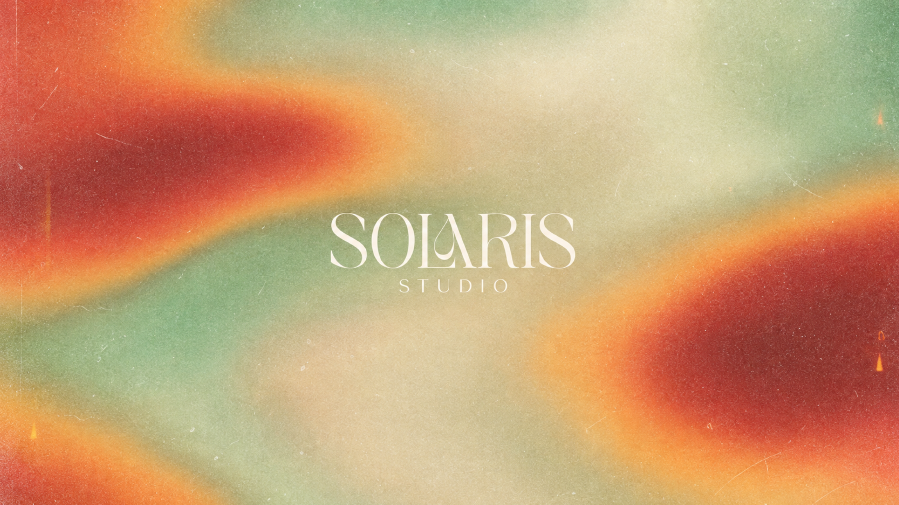
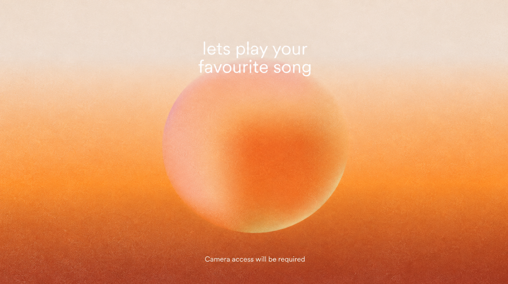
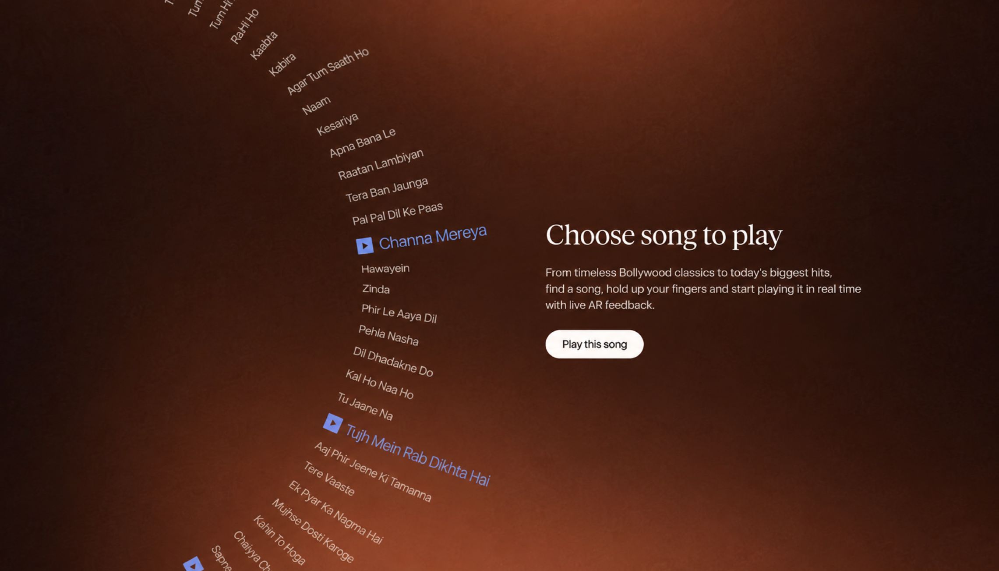
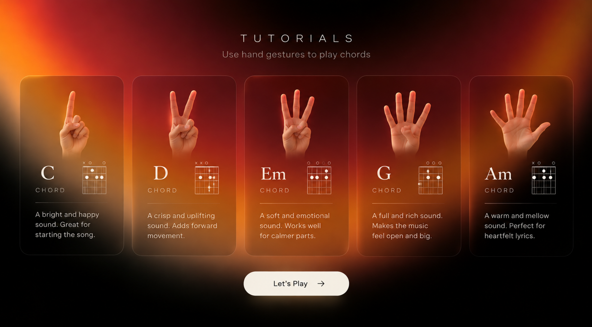
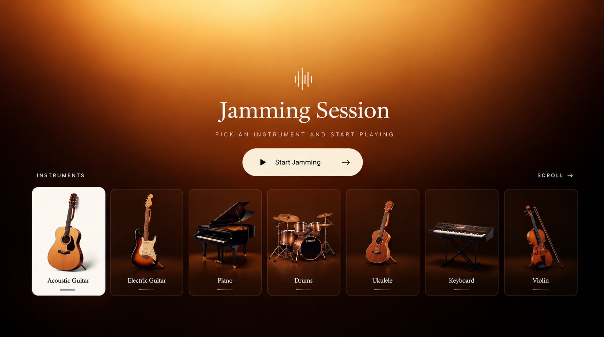
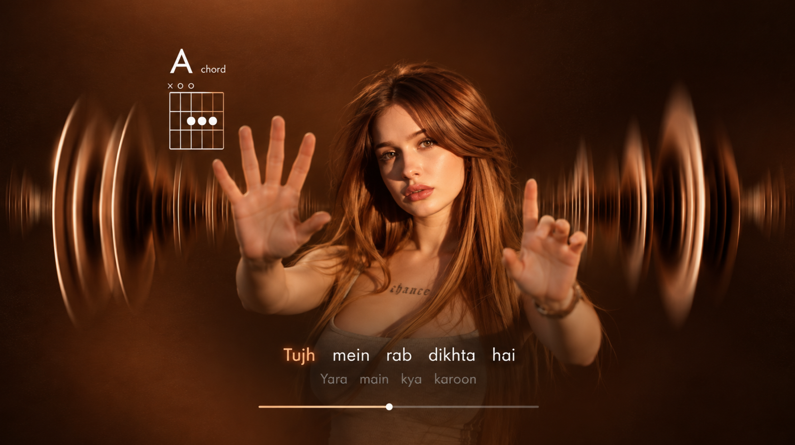

# Solaris Studio









An augmented-reality gesture instrument for Windows laptops. You hold up fingers to choose guitar
chords, your other hand shapes the sound, and the song plays karaoke-style around a live, segmented
view of you from your webcam.

Built with Unity 6 (6000.0.39f1), URP 17, Sentis 2.6.1 on the GPU and MediaPipe hand, face and
selfie models. All sound is synthesized live, so the app needs no audio samples.
Read [docs/ARCHITECTURE.md](docs/ARCHITECTURE.md) for the design and the tracking pipeline.

## Run it

```
Builds\SolarisStudio\SolarisStudio.exe
```

It starts fullscreen. F11 (or Alt+Enter) toggles windowed mode. The app picks your FHD webcam and
skips the IR (Windows Hello) camera.

| Scene | What to do |
|---|---|
| 1 Title | Your key art, only the red glows are alive. Any key or click |
| 2 Welcome | Enter starts the camera and loads hand tracking |
| 3 Song dial | Draw circles with your index finger (clockwise gives the next song). Pinch and hold, or press Enter, to play. ↑/↓ and the mouse wheel also work |
| 4 Chords | 1 finger = **C**, 2 = **D**, 3 = **Em**, 4 (thumb folded) = **G**, open palm = **Am**. Each card lifts and strums as you make its gesture. Keys 1–5 preview a chord |
| 5 Controls | Second hand: height sets volume, tilt sets tone, open or curled sets major or minor, left/right sets direction |
| 6 Jamming | Acoustic guitar is live. The other instruments are marked *soon* |
| 7 Stage | The band follows the chart and your hands play the guitar. A fist mutes. Esc/P pauses. Results appear at the end |

The hand on **your left** plays chords and the other hand shapes the sound. Press **H** to swap
(for left-handed players). **F1** opens a diagnostics overlay with landmarks, fps, inference time,
finger states and audio. **C** cycles cameras and **M** toggles mirroring.

If the camera doesn't open, check Windows Settings → Privacy & security → Camera →
"Let desktop apps access your camera". Without a camera the app still runs on keyboard and mouse.
On the Stage, keys 1–5 hold a chord.

## Songs

Nine public-domain songs (plus your Channa Mereya demo) ship in `Assets/StreamingAssets/Songs` (the build copies them to
`SolarisStudio_Data/StreamingAssets/Songs`). To add your own, drop a JSON file there:

```json
{
  "title": "My Song", "artist": "Me", "blurb": "One line for the song dial.",
  "difficulty": "Easy", "bpm": 90, "meter": 4, "pickup": 0,
  "chords": "G | C:2 G:2 | Em | D",
  "lyrics": [ "Hel-:1 lo:1 world,:2 | _:2 it's:1 me:1" ]
}
```

* In `chords`, each token is one bar, or `Chord:beats` to split a bar. `|` is ignored. The
  gesture chords are C, D, Em, G and Am, plus their twins Cm, Dm, E, Gm and A (the major/minor gesture).
* In `lyrics`, each token is `word:beats`. `_` is a rest, `syl-` joins the next syllable, and
  `one--` keeps a real hyphen. Lines follow each other in time. `pickup` shifts the first line
  earlier than bar 1.
* Optional `"patterns": ["bar:pattern", ...]` changes the right hand from a bar onward. Each pattern is
  one step per eighth note: `D`/`U` strum down/up, `.` rest, `B` picks the chord's bass string, and `1`..`6`
  pick one string (1 = high E). For example `"0:B3231323"` fingerpicks and `"12:D.DU.UDU"` strums.
* Optional `"drums": false` turns the band into a ballad backing: bass and pad, no kick or shaker.
* Lyrics you type yourself can live next to the chart in `<id>.lyrics.txt`. Each line starting with `>`
  replaces one chart lyric line, in order, with its words spread across that phrase. Empty slots keep the
  chart's line.
* Check your charts with `python Tools/validate_songs.py`.

**Channa Mereya** (`channa_mereya.json`, personal demo) plays along with the guitar + drums karaoke
track you supplied (`channa_mereya_backing.wav`: 0:40 to 2:17 of the record, the first verse into the
first chorus). The chart was measured from that file:
* tempo 90 BPM, chart beat 0 = 5.433 s into the WAV (within about 5 ms of the record's beats), tuned +9 cents;
* chords Am F Dm C/G through the verse, then Am Dm Bb C in the chorus;
* its own gestures: 1 = C, 2 = Dm, 3 = F, 4 = G, 5 = Am, and 3 fingers with the other hand curled = Bb.

The record follows your hands: on the right chord it plays full, on a wrong chord it dips and dulls under
your clashing strum, and with no hand it sinks back. Lyric lines are timed to the record. You can nudge
any line by editing its leading `_:beats` rest.

Other optional song fields: `"backing"` (16-bit PCM WAV in this folder), `"backingOffset"` (seconds of the
WAV at beat 0), `"tuningCents"`, `"gestures"` (5 chords for 1-5 fingers) and `"alternates"`
(`"F:Bb"` = the chord when the other hand curls). Test switch: `-solaris-hold <chord>` holds one chord
for the whole song, so you can hear a wrong chord against the record.

Commercial songs, including the Bollywood titles in the mock-ups, are copyrighted. Add them only
with lyrics you're licensed to use.

## Develop and test

```
# one-time/idempotent project setup (URP, player, fonts, registry, scene)
Unity -batchmode -quit -projectPath . -executeMethod Solaris.EditorTools.ProjectSetup.Run

# 58 EditMode tests: finger counting (rig ⇄ analyzer loop), circle gesture, crops, filters,
# song charts, voicings, string pitch, sequencer, reference-matched text fitting
Unity -batchmode -projectPath . -runTests -testPlatform EditMode -testResults Logs/tests.xml

# build
Unity -batchmode -quit -projectPath . -executeMethod Solaris.EditorTools.BuildTool.BuildWindows
```

The player also takes automation flags. In these runs the webcam is **never** opened; only test
images are used.

```
SolarisStudio.exe -solaris-selftest-vision TestData -solaris-capture Captures/vision
SolarisStudio.exe -solaris-screen stage -solaris-camera-image TestData/two_hands_woman.jpg ^
                  -solaris-autoplay -solaris-song amazing_grace -solaris-capture out.png -solaris-delay 12 ^
                  -solaris-record-audio out.wav
```

Art pipelines are in `Tools/`:

* `make_title.py` splits the Scene 1 key art into a colour field (only its red glows are animated), a
  static film layer (grain, dust, light-leak flecks) and the traced SOLARIS / STUDIO lettering. At
  rest these rebuild the original image to within 0.44/255.
* `make_welcome.py` splits the Scene 2 art into the sky, static grain and the orb (straight alpha,
  colour solved in linear light, crisp rim included) so the orb can bounce. The sky under the orb and
  the text is rebuilt with borrowed mottling, so nothing shows when the orb lifts. At rest the layers
  rebuild the original to within 0.11/255.
* `make_tutorials.py` lifts the Scene 4/5 backdrop and each glass card (with its photographic hand
  and icons) out of the mock-ups. It removes their text, dividers and diagrams and records where every
  line sat, so the game re-typesets them crisply in the same place (`TutorialBoard` + `RefSpace`).
* `make_logo.py` builds the SDF wordmark.
* `blender/make_instruments.py` models and renders the instrument cards in Blender 5.1 with Cycles/OptiX.
* `crop_instruments.py` crops those renders.

## Credits and licences

* Fonts: Italiana, Playfair Display, Figtree and EB Garamond (SIL OFL 1.1, licence files next to the fonts).
* Models: MediaPipe BlazePalm, hand landmarker and BlazeFace (Apache-2.0, via Unity's Hugging Face
  conversions). Selfie segmenter landscape (Apache-2.0, `onnx-community`).
* Test photos in `TestData/` come from Wikimedia Commons (CC BY-SA). See `TestData/CREDITS.md`.
  They are not shipped in builds.

Before a public release, upgrade the editor to 6000.0.58f2 or later (CVE-2025-59489) and rebuild.
